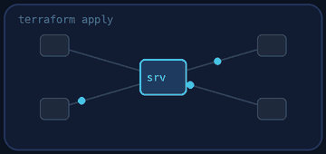
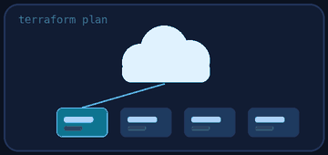
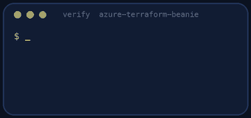
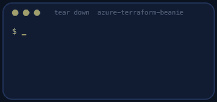

<p align="center"></p>

| | |
|-|-|
| **Time** | 105-120 min |
| **Cost** | a few cents (one small VM for two hours) |
| **You need** | An Azure subscription where you can create resources, the Azure CLI (`az login` done), Terraform 1.10 or newer, an SSH client, curl, Python 3 and a terminal |

## How this lab works

1. **Fork** this repository to your own GitHub account (button at the top right).
2. Clone **your fork** in your Ubuntu environment (WSL on Windows, your OrbStack machine on Mac).
3. Read the lab below (the same text is in [`LAB.md`](LAB.md)) and follow the mission.
4. Answer the questions in [`SUBMISSION.md`](SUBMISSION.md). Where a question asks for output, paste it in a code block. No screenshots needed.
5. Commit and push. Open the **Actions** tab of your fork (click *I understand my workflows, go ahead and enable them* the first time). The **Lab check** shows what is still missing.
6. When the check is green, **submit the URL of your fork** in the course platform.

> [!NOTE]
> The check only looks at your answers and any files the lab asks you to commit. Your instructor reads your work and may ask you to explain any line.

<p align="center"></p>

## 🎬 The situation

<p align="center"></p>

```text
CLIENT CALL - transcript
Client : "Someone cleaning the subscription deleted the resource group.
          How long to bring Beanie back?"
You    : "Half a day. And we will not be sure it is identical."
Client : "..."
```

In the first Azure lab you built the server with about fifteen `az` commands. They worked, and they were typed once in one terminal and never saved. That answer is not good enough twice.

You will write the environment as **Terraform** with the `azurerm` provider, so it can be created, destroyed and created again **identically** with one command. The VM's first-boot script (`cloud-init.yaml`) is provided complete: it is the one from the first Azure lab. The new part is the resource group, the network, the firewall, the public IP and the VM, and what Terraform tells you when reality and code disagree.

> [!IMPORTANT]
> **Your mission**
> - Write `terraform/main.tf`: provider, resource group, network, NSG with the two rules, public IP, NIC and VM
> - Apply it and use Beanie from the internet
> - Change something by hand in the portal and let Terraform notice (drift)
> - Destroy it and rebuild it, then prove it and tear down

**Time:** 105-120 min | **Cost:** a few cents | **You need:** an Azure subscription where you can create resources, the Azure CLI (`az login` done), Terraform 1.10 or newer, an SSH client, curl, Python 3 and a terminal.

<p align="center"></p>

## Part 0 - Prepare

Fork this repository, clone your fork and run:

```bash
./setup.sh
```

It checks your tools and login, creates an SSH key in `keys/` and writes `terraform/terraform.tfvars` (your subscription id and your public IP, **not committed**). It creates nothing in Azure. Read `terraform/variables.tf` (provided) and `cloud-init.yaml`.

> [!NOTE]
> **Think** The IP address of your laptop ends up in a file that is not in git. Why is it a variable with **no default** and a validation rule? Who should decide that value: the code or the person who runs it?

<p align="center"></p>

## Part 1 - Write the environment

<p align="center"></p>

Open `terraform/main.tf`: a list of five TODOs. Write them using the documentation of the `azurerm` provider (registry.terraform.io/providers/hashicorp/azurerm). Resource names (so that the checker and the portal agree): resource group `rg-beanie-tf`, VM `vm-beanie`, tags `lab = azure-terraform-beanie` everywhere tags are supported.

Rules that the checker will enforce, in the same spirit as the `az` version:

- SSH from **`var.my_ip_cidr` only**, never `*`; port 8000 from `Internet`
- the NSG **attached to the subnet**
- public IP `Standard` and `Static`
- **no password authentication**, an SSH key only
- the VM size from `var.vm_size`

```bash
cd terraform
terraform init
terraform fmt
terraform validate
terraform plan
```

Read the plan before you apply. Count the resources. Which one will be created first and why? (Terraform builds a dependency graph from the references between resources: `azurerm_resource_group.main.name` inside another resource is an arrow.)

> [!NOTE]
> **Predict** There is no `depends_on` anywhere in your file. What stops Terraform from trying to create the VM before the network interface exists?

<p align="center"></p>

## Part 2 - Apply, use it

```bash
terraform apply
terraform output
curl http://<public ip>:8000/api/menu      # cloud-init needs 3 to 6 minutes
```

**VM size.** The default `Standard_D2s_v3` works in most subscriptions. `Standard_B1ms` is cheaper but restricted in some. If your apply fails with `SkuNotAvailable` that is not a mistake in your code: it is a fact about your subscription, and it is why the size is a variable. Change it in `terraform.tfvars`, not in `main.tf`.

> **Quota and capacity are normal in Azure. Do not be afraid of them.** Azure shares real hardware between millions of customers, and when a region is in demand a new subscription can get `QuotaExceeded` ("approved cores quota") or `SkuNotAvailable` ("Capacity Restrictions") for some VM sizes. Professionals meet this every month, and nobody judges you for it. What to do, in this order:
>
> 1. **Read which one it is.** `QuotaExceeded` means your *subscription limit* for that VM family is too low (often 0 on a new subscription). `SkuNotAvailable` means Azure has no capacity of that size in that region for you right now.
> 2. **See your numbers:** `az vm list-usage -l <region> -o table` (current value and limit per family).
> 3. **Ask for more quota, it is a normal request:** Azure portal > **Quotas** > **Compute** > pick the region and the VM family > **Request adjustment** (a few cores, for example 4 or 10, is usually approved in minutes, automatically). If the portal says it cannot, open a support request of type *Service and subscription limits (quotas)*.
> 4. **While you wait, use something else:** a different size of the same class (for example `Standard_D2s_v3` instead of a B-series), or a different region (`az vm list-skus -l <region> --resource-type virtualMachines --query "[?length(restrictions)==\`0\`].name" -o tsv`). Put the size and the region in variables so changing them costs one line.
> 5. **Write down what you did** in your submission: which error, which request, how long it took. That is real work, not a detour.


<p align="center"></p>

## Part 3 - Drift

The code says SSH is open to one address. In the Azure portal, open the NSG and change the SSH rule's source to `Any`. Then:

```bash
terraform plan
```

Terraform reads the real world, compares it with the state and the code, and tells you what it would change to put things back. Read it. Do **not** apply yet.

> [!NOTE]
> **Think** Terraform found the change in seconds. A human auditor would have found it in a year, or after the incident. What does that say about who should be allowed to change infrastructure by hand? Apply to fix it, and keep the plan output for question 4.

<p align="center"></p>

## Part 4 - Destroy it, build it again

```bash
terraform destroy
terraform apply
```

Compare the two applies. Is the public IP the same? (A *Static* Standard public IP keeps its address while it exists; destroying it releases the address.) Wait for cloud-init and use Beanie again without touching the VM. What does that say about where the *configuration* of the server lives?

<p align="center"></p>

## Part 5 - Prove it

<p align="center"></p>

```bash
./verify.sh
```

It checks your code (format, variables, no secrets in git), reads the **real resources** in Azure, runs `terraform plan` and requires "no changes", and uses Beanie from the internet. Fix what is red and run it again until it ends with **ALL CHECKS PASSED**. **Paste the output into `SUBMISSION.md` before you tear down.**

> [!TIP]
> **Stuck?** `SubscriptionNotFound`/authorization errors: `az login` again and check `subscription_id`. `SkuNotAvailable`: change `vm_size`. `Error: building account: ... azurerm_...`: check `provider "azurerm" { features {} }`. Plan shows changes after apply: a value differs from what Azure normalised (for example the SSH rule's source). Beanie does not answer after 8 minutes: `az vm run-command invoke ... 'tail -50 /var/log/cloud-init-output.log'`.

<p align="center"></p>

## Level up (optional)

- Move the state to an Azure Storage backend with a lease lock. What stops two engineers from applying at the same time?
- Turn the VM into a `azurerm_linux_virtual_machine_scale_set` with 2 instances behind an `azurerm_lb`. What changes in the NSG and in cloud-init?
- Add `azurerm_management_lock` (CanNotDelete) on the resource group. What happens to your `terraform destroy`, and to your colleague's accidental delete?
- Compare: which parts of the `az` version of this lab were easier, which were harder to get right?

<!-- teardown:start (generated by labs.py, do not edit) -->
## Tear down (mandatory)

<p align="center"></p>

Resources left behind cost money, keep doors open and pollute the next lab. Removing what you created is part of the job, so it is part of the submission: **you must prove it is gone**.

Do this **last**, after you have pasted your `verify` output into `SUBMISSION.md` (once you tear down, the lab can no longer be verified).

1. Run `./teardown.sh` (it runs `terraform destroy`, then deletes anything left in the resource group `rg-beanie-tf`).

Then run the proof:

```bash
./verify-teardown.sh
```

It prints a list of checks and must end with **TEARDOWN VERIFIED**. If it reports leftovers, remove them and run it again. Paste the full output in your submission.
<!-- teardown:end -->

<!-- submission:start (generated by labs.py, do not edit) -->
## 📬 Submission

Answer the questions in `SUBMISSION.md` in **your fork** (paste output in code blocks where asked), push, then submit the **URL of your fork**.

**Files to commit**

- `terraform/main.tf`: the resource group, network, firewall, public IP and VM
- `notes.md` with your commands (optional)

**Questions to answer**

1. Paste `terraform plan` before the first apply (the summary line) and `terraform output`. Which resource did Terraform create first and how did it know the order? Draw two arrows of the dependency graph.
2. Map your Terraform resources to the `az` commands you used in the first Azure lab. Which one command became several resources, and which resource has no `az` equivalent you remember?
3. The VM size comes from a variable. Why is a size that is restricted in a subscription a problem for IaC and not for a click in the portal? How did you find a size that works?
4. Change the SSH rule in the portal (open it to *) and run `terraform plan`. Paste what Terraform wants to do. Then apply. What did you just learn about drift and about who is allowed to change things by hand?
5. Run `terraform destroy` then `terraform apply` again and paste the end of both. Is the public IP the same? Does Beanie answer after the rebuild without you touching the VM, and why?
6. Where is your Terraform state stored and what is in it that you must never commit (hint: look for the SSH key and the public IP)? Name one problem of local state for a team.
7. Paste the output of `./verify.sh`. It must end with **ALL CHECKS PASSED**.
8. **Tear down.** Paste the output of `./verify-teardown.sh`. It must end with **TEARDOWN VERIFIED**.
<!-- submission:end -->
